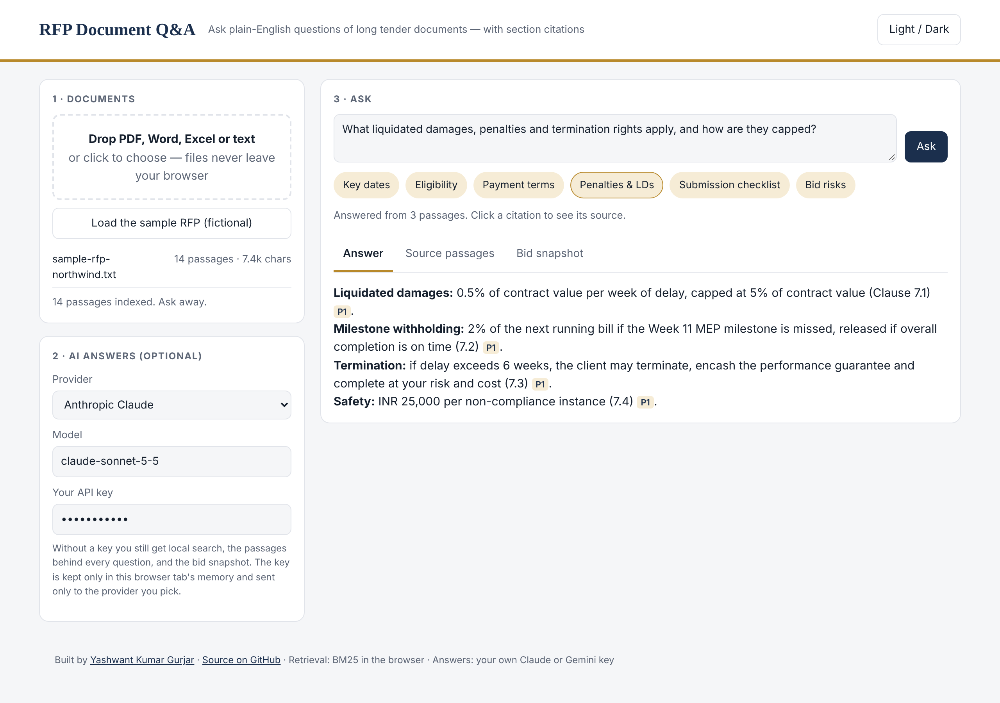
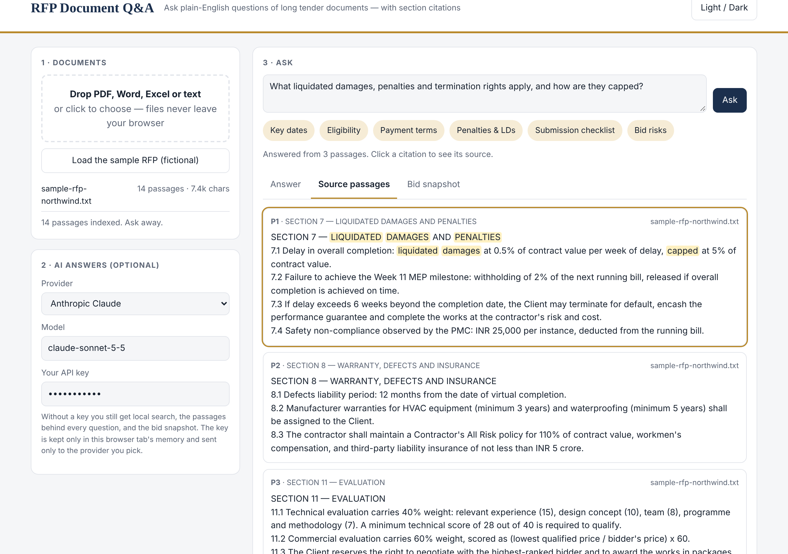
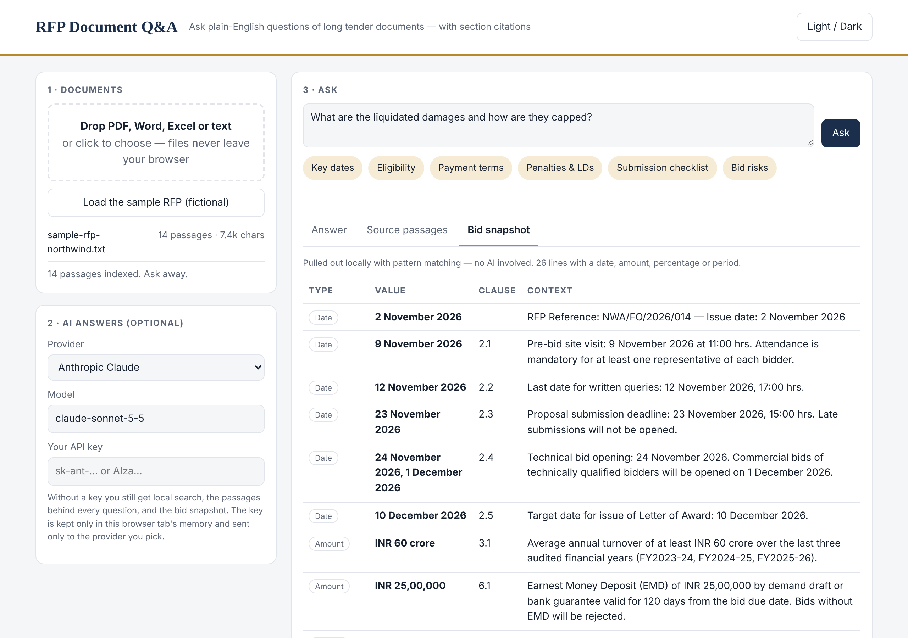

# RFP Document Q&A

**Ask plain-English questions of a 100-page tender and get answers with the clause they came from.**

**▶ Live demo: [yashkasana1996.github.io/rfp-document-qa](https://yashkasana1996.github.io/rfp-document-qa/)** — click *Load the sample RFP*, then any quick question. Works without an API key.

   



---

## The problem

Bid teams receive RFPs that run 30–150 pages. Before anyone can price the job, someone has to dig out the deadlines, eligibility rules, payment terms, penalties and the submission checklist — by reading the whole thing. Two people reading the same document routinely come away with different lists, and a missed clause (an uncapped penalty, a mandatory site visit) costs real money.

## What it does

| | |
|---|---|
| **Reads anything** | PDF, Word, Excel/CSV and text — parsed entirely in the browser (pdf.js, mammoth, SheetJS). Files are never uploaded anywhere. |
| **Finds the right clauses** | Splits the document into clause-aware passages and ranks them with BM25 search plus tender-specific synonyms ("penalty" also finds *liquidated damages*). |
| **Answers with citations** | Sends only the top passages to Claude or Gemini with a bid-manager prompt; every claim is tagged `[P1]`, `[P2]` — click a tag to jump to the source passage. |
| **Bid snapshot — no AI** | Pulls every date, rupee amount, percentage and period into one table with its clause number, using pattern matching alone. |
| **One-click questions** | Key dates · Eligibility · Payment terms · Penalties & LDs · Submission checklist · Bid risks |

| Source passages (local search, no key) | Bid snapshot (no AI) |
|---|---|
|  |  |

## Design decisions

- **Retrieval before generation.** The model only sees the 3–6 most relevant passages, which keeps answers grounded, costs low and long documents within limits.
- **Useful without AI.** Search, highlighted passages and the snapshot all work with no key — the AI step is an upgrade, not a dependency.
- **Bring your own key, keep your data.** Keys stay in the tab's memory and go straight to the provider you choose (Anthropic or Google). No server, no logging.
- **Zero install.** One HTML file: open it locally or host it on GitHub Pages.

## Run it

```bash
git clone https://github.com/yashkasana1996/rfp-document-qa
cd rfp-document-qa
python build.py        # inlines samples/ into index.html
open index.html        # or double-click it
```

Edit the app in `src/app.html`; `build.py` produces `index.html`.

## Where this pattern applies

The same upload → retrieve → cite flow works for contract review, policy and compliance manuals, insurance wordings, lease abstracts and audit evidence — anywhere people need fast, traceable answers from long documents.

## Background

I first built this to speed up tender review for a design-and-build contracts team; this public version is rebuilt from scratch with a fictional sample RFP and no client material.

---

Built by **Yashwant Kumar Gurjar** — I design and build AI tools for operations-heavy businesses.
[Portfolio](https://yashkasana1996.github.io) · [LinkedIn](https://linkedin.com/in/yashwant-gurjar96) · yashkasana6991@gmail.com

*The sample RFP, company names and figures are fictional. The answer screenshot shows a representative model response to the sample document.*
